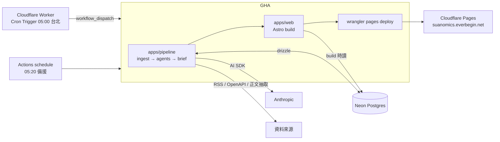

# 設計依據

讀者：維護者、在本 repo 工作的 AI coding agent
型別：說明

本頁描述 Suanomics 的目標架構：系統由哪些部分組成、每個部分為什麼長這樣、邊界在哪裡。每個「為什麼」只寫一句結論，完整取捨在 [docs/adr/](../adr/) 對應的決策紀錄。實作進度與排程在 GitHub Issues 的 milestone，本頁不記進度。

## 目標與讀者

Suanomics 每個台股交易日開盤前產出一份總經報告，說明前一晚世界發生了什麼、透過什麼機制牽動哪些台股標的、方向為何，每條連動鏈附引用來源。第一讀者是維護者本人，公開網站供任何人閱讀。

三個設計約束決定了後面所有選擇：

| 約束 | 內容 |
|---|---|
| 成本 | 基礎設施以免費層為主；LLM 用量走 Anthropic Console，額度是 Max 方案附帶的每月 API credits（US$100），每日上限見 `DAILY_COST_LIMIT_USD` |
| 有憑有據 | 每條連動鏈的數字、事件、因果都要能追到來源；投信投顧法禁用語句在 system prompt 層硬式攔截 |
| 一人維護 | 沒有常駐服務要顧、沒有排隊系統要調；pipeline 跑完就結束 |

## 系統形狀

系統是一條排程批次 pipeline 加一個靜態網站，沒有常駐 server。決策見 [排程批次加靜態網站，不養常駐 server](../adr/0002-batch-pipeline-and-static-site.md)。

| 部分 | 職責 | 託管 | 決策紀錄 |
|---|---|---|---|
| 觸發器 | Cloudflare Worker 的 Cron Trigger 每日 05:00（台北）呼叫 GitHub API `workflow_dispatch`；Actions 自己的 `schedule` 在 05:20 當備援，pipeline 開頭查當日已有產出就結束 | Cloudflare Workers 免費層 | [觸發器以 Cloudflare Worker 為主、Actions schedule 為備援](../adr/0009-cron-trigger-via-cloudflare-worker.md) |
| Pipeline | TypeScript CLI：判斷交易日、抓資料、跑 agent、寫 brief 到 Postgres；非交易日（週末與 TWSE 休市日）直接結束 | GitHub Actions（public repo 免費） | 同 0002 |
| 持久狀態 | storylines（跨日敘事線與週回顧）、近日 brief 摘要、market data 歷史、news 候選池；drizzle schema 與 repos | Neon Postgres 免費層 | [持久狀態放 Neon Postgres、沿用 drizzle](../adr/0003-neon-postgres.md) |
| 網站 | Astro 在同一個 Actions job 內 build，直接讀 Postgres 產成純 HTML，`wrangler pages deploy` 上線 | Cloudflare Pages，自訂網域 `suanomics.everbegin.net` | [網站用 Astro 靜態產生](../adr/0005-astro-static-site.md) |
| 每日花費閘 | pipeline 累計每次 LLM 呼叫的 `totalCostUsd`，超過設定上限即停止並標記該日報告未完成 | pipeline 內 | — |
| LLM 用量帳本 | 每次 LLM 呼叫寫一列 `llm_calls`（不含 provider 專屬欄位），Actions job summary 與 `llm:usage` CLI 由此取數；寫入失敗不擋 run，但留 annotation 與整列 log。花費閘不讀帳本，每次 run 獨立計算 | pipeline 內 | — |
| LLM 帳務錯誤 | 額度、帳務、認證錯誤穿透所有降級 catch 讓 run 失敗，不發佈殘缺報告；辨識不了的錯誤照一般錯誤重試與降級 | pipeline 內 | — |

Pipeline 的一次執行是固定順序的 DAG，不是 agent 自主迴圈：每個階段「給 system prompt 與結構化輸入，要一份符合 Zod schema 的 JSON」。

## 交易日與休市期間

是否產報告只看 TWSE 開休市，美股休市不影響。週末與 TWSE 休市日都是非交易日，`daily` 回 `skipped: non-trading-day`，不產報告；週日特輯不在每日流程內。交易日判斷用 `packages/shared` 的手動休市表，表的涵蓋終點前 30 天由 time-bomb 測試轉紅，逼年度更新。

距上一個交易日超過 1 個曆日的交易日是「休市後第一個交易日」，條件不寫死週一，連假後同樣適用。這天的報告統整上一個交易日收盤後到當日開盤前的整段休市期間：

| 環節 | 規則 | 理由 |
|---|---|---|
| 候選窗 | 往回涵蓋到上一個交易日那次執行抓到的新聞：曆日差加 1 天，上限 14 天。一般交易日仍是 2 天 | 窗以上一個交易日為錨，日後非交易日也抓新聞時，那幾天抓到的新聞自動落在窗內 |
| 選稿名額 | 總數維持 36、各類保底不變，不隨天數放大；休市期間逐日輪流入選，上一個交易日之前的舊聞排最後 | 名額放大會讓 editor 輸入與花費跟著連假長度漲；逐日輪流就足以避免休市期間的新聞被當日新聞擠掉 |
| prompt | editor 與 narrative-writer 的 user content 加一段統整指示：交代上一個交易日與休市區間、要求統整整段期間、以日期而非「昨夜」指稱事件，並帶入 compliance 禁用語清單。一般交易日不加 | 只進 editor 時主文仍會把多日事件講成一晚 |

休市表是事先維護的，兩種例外的處理：

- **颱風等臨時休市**：維護者把日期補進休市表。沒補時當天照常產出一份報告，隔天不被當成休市後第一個交易日；候選窗仍涵蓋臨時休市那天抓到的新聞，素材不會漏，只少了統整指示。
- **補行交易日**：TWSE 現行不在補班的週六開市，休市表也不支援「週末開市」。日後若恢復，要另加一張補行交易日表，`isTwseTradingDay` 先查它。

## Workspace 與依賴方向

pnpm workspace 四個成員：

| Workspace | 職責 | 可以 import |
|---|---|---|
| `packages/shared` | brief 的 Zod 契約、compliance 禁用語、citation 驗證規則 | 只有 zod |
| `apps/pipeline` | ingest、agents、prompts、drizzle schema 與 repos、CLI 入口、花費閘 | `shared` |
| `apps/web` | Astro 網站；build 時讀 Postgres | `shared`（型別與 schema）、drizzle client |
| `apps/trigger` | Cloudflare Worker，Cron Trigger 呼叫 `workflow_dispatch` | 無 |

`apps/web` 不 import `apps/pipeline`；eslint 的 `import-x/no-restricted-paths` 強制這條邊界。後端語言只有 TypeScript，決策見 [後端維持 TypeScript](../adr/0006-typescript-only-backend.md)。

## LLM 呼叫層

所有 LLM 呼叫走 Vercel AI SDK 的 `generateText` 加 `Output.object({ schema })`。provider 只接 `@ai-sdk/anthropic`。不引入 agent 框架，決策見 [LLM 呼叫層用 Vercel AI SDK、不用 agent 框架](../adr/0004-ai-sdk-no-agent-framework.md)。

每個 agent 用哪家哪個 model 由 `apps/pipeline/src/agents/models.ts` 的對照表決定，具體型號以那裡為準，環境變數 `AGENT_MODELS` 可逐 agent 覆寫：

| 分層 | 預設 model 等級 | 適用 agent |
|---|---|---|
| 高量、低複雜度 | 便宜、快速的等級 | news-categorizer、news-tagger、chain-grouper、corpus-entity-summary |
| 分析與綜合 | 能力較高的等級 | decomposer、analyst-tier1、analyst-tier2、synthesizer、editor、viewpoints-debate、narrative-writer、podcast-writer |
| 品質評審（judge） | 與分析綜合同等級 | brief-judge、brief-quality-judge、brief-continuity-judge |

judge 用不同家族的 model 可避免同家族評自己的輸出；全部用 Anthropic，是否換家族在接回 judge 時（#33）決定。system prompt 透過 `providerOptions.anthropic.cacheControl` 開 prompt caching。

## 資料來源

新聞只收「官方機構或發行商自己發布的 feed」，不買新聞 API，正文自己抽取。決策見 [新聞來源只用 feed 與自抽正文、不買新聞 API](../adr/0007-news-sources.md)。來源清單、各來源的條款連結與允許用法逐條記在 `docs/sources.md`。

| 類型 | 來源 | 用法 |
|---|---|---|
| 官方機構新聞稿 | 央行、金管會、行政院、總統府、外交部、疾管署、聯準會、白宮、美國國務院等 RSS，GDACS 災害警報 | 標題、正文、連結；條款或 robots 限制時只用 feed 內容 |
| 發行商自有 feed | 鉅亨網、中央社的公開 RSS；條款禁止或 robots 封鎖本用途的媒體不接，逐項理由見 `docs/sources.md`；v1 沒有需要 RSSHub 的來源，日後需要時在 Actions job 內自架 | 標題、連結；前言依該站條款 |
| 結構化資料 | TWSE OpenAPI（新聞列表、MI_INDEX、外資持股、融資融券）、公開資訊觀測站重大訊息（TWSE／TPEx OpenAPI）、FRED、EIA、台美經濟日曆 | 數字與事件 |

正文抽取在 pipeline 內用 Readability 類函式庫完成；抽不到的頁面才落到 Firecrawl 免費層。新聞進來先由 `news-categorizer` 分成六類——總經、地緣、產業、能源、天災公衛、其他——選稿時每類有保底名額，避免財經版獨佔。

## 安全

repo 是 public，金鑰防線分三層：

| 層 | 措施 |
|---|---|
| 進不了 repo | GitHub secret scanning 與 push protection；gitleaks 在 husky pre-commit 與 CI 各跑一次；`.env*` 在 `.gitignore`，`.env.example` 只有 key 名 |
| 拿不到 secrets | workflow `permissions: contents: read`；第三方 action 釘 commit SHA；不用 `pull_request_target`；secrets 放 GitHub Environment `production`，只有 `main` 可讀（重寫期間 `rewrite` 也可讀，接回 `main` 時收回） |
| 流出也有上限 | Anthropic Console workspace spend limit；Cloudflare API token 只給 Pages deploy 權限；Neon 用獨立 role；`main` 分支保護：必須走 PR、CI 綠、禁 force push（重寫期間 `rewrite` 套同樣的保護） |

## 不做的事

- 線上即時分析（讀者貼文章、後端即時算）與即時事實查核；維護者本機跑 CLI 即可。
- 用戶註冊、登入、付費、LINE Bot、券商 API。
- agent 框架（ADK、Hermes Agent 之類）與自主研究迴圈；pipeline 是決定性的 DAG。
- OpenAI 相容端點路徑。
- 向量檢索式 RAG；語料規模用 prompt 直接塞入。
- 把後端換成其他語言。

## 相關 repo

Prompt 研究工具（從 YouTube／podcast 逐字稿蒸餾分析框架、編成 prompt 候選）是獨立 repo `baguanomics`，與本 repo 零 package 依賴。介面是檔案：本 repo 提供各 agent 的「目標 prompt 規格」檔，工具輸出 candidate 與 diff。決策見 [Prompt 研究工具拆成獨立 repo，介面是檔案](../adr/0008-split-prompt-research.md)。

## 決策紀錄索引

| 編號 | 標題 |
|---|---|
| 0001 | [在同一 repo 以 orphan branch 重寫](../adr/0001-orphan-branch-rewrite.md) |
| 0002 | [排程批次加靜態網站，不養常駐 server](../adr/0002-batch-pipeline-and-static-site.md) |
| 0003 | [持久狀態放 Neon Postgres、沿用 drizzle](../adr/0003-neon-postgres.md) |
| 0004 | [LLM 呼叫層用 Vercel AI SDK、不用 agent 框架](../adr/0004-ai-sdk-no-agent-framework.md) |
| 0005 | [網站用 Astro 靜態產生](../adr/0005-astro-static-site.md) |
| 0006 | [後端維持 TypeScript](../adr/0006-typescript-only-backend.md) |
| 0007 | [新聞來源只用 feed 與自抽正文、不買新聞 API](../adr/0007-news-sources.md) |
| 0008 | [Prompt 研究工具拆成獨立 repo，介面是檔案](../adr/0008-split-prompt-research.md) |
| 0009 | [觸發器以 Cloudflare Worker 為主、Actions schedule 為備援](../adr/0009-cron-trigger-via-cloudflare-worker.md) |
| 0010 | [Podcast 語音只用 Azure Speech](../adr/0010-azure-tts-only.md) |
